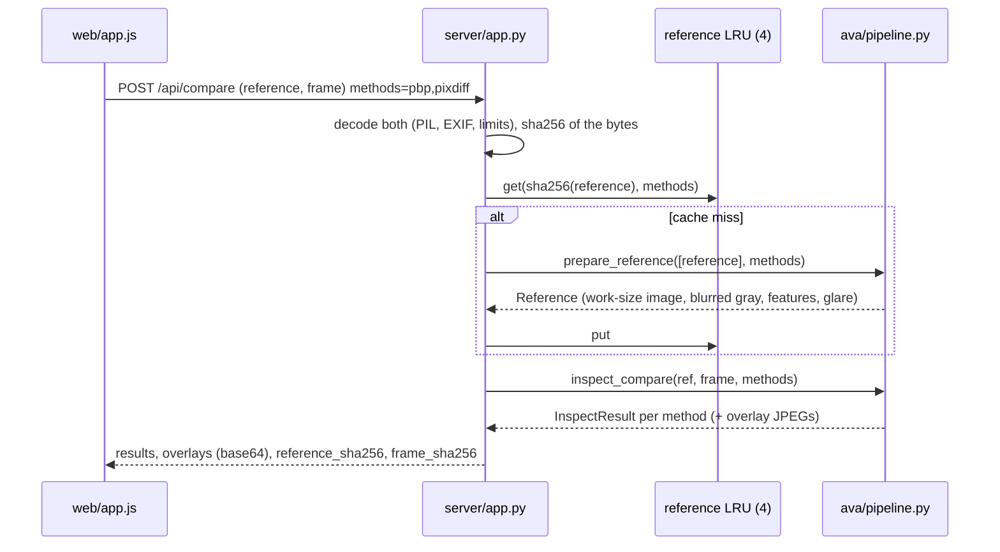
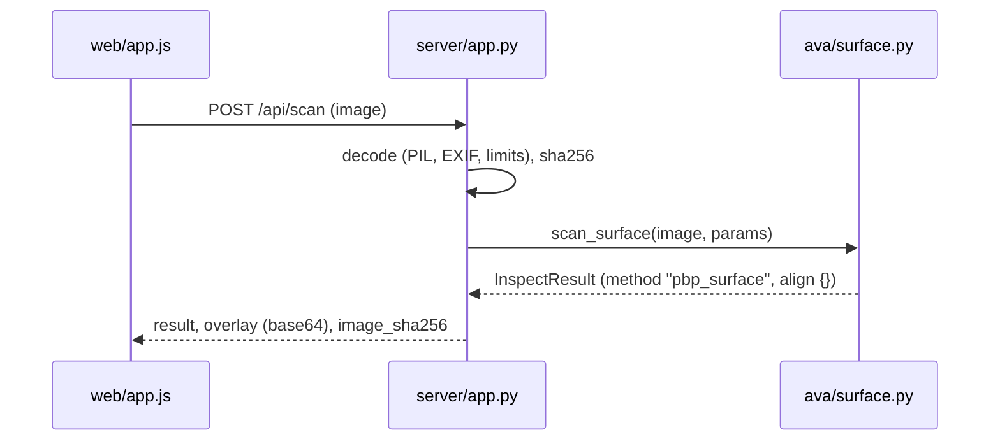

# AVA — architecture

This document describes the code as it is. If the two disagree, [SPEC.md](SPEC.md) is the contract. All tunables live in `ava/config.py::Params`. The defaults quoted below are the values in that file; the live values come from `GET /api/health`.

## 1. Modules

| Module | Responsibility |
|---|---|
| `ava/config.py` | `Params`, one dataclass holding every threshold and size, including the calibrated thresholds. |
| `ava/pbp.py` | Exact PBP (`pbp_reference`, `format_polynomial`, `poly_degree`), vectorised window signatures (`window_signatures`), `pair_distance`, `serialize_signatures` and the grid helpers (`grid_shape`, `cell_mask_from_pixel_mask`). |
| `ava/change.py` | Tolerant, symmetric change map for any window distance; minimum over several references. |
| `ava/align.py` | Registration of the Check photo onto the Reference: identity, then ORB, then ECC, plus the part-motion handling. `AlignResult`, `corner_shift`, `resize_max_side`. |
| `ava/quality.py` | Glare mask, gain-invariant blur score, dark check, capture report, ghost-outline PNG. |
| `ava/zones.py` | Changed cells to ranked zones with hints (`extract_zones`); `coverage`. |
| `ava/baselines.py` | SSIM, Census and plain subtraction (`pixdiff`) on the same grid with the same distance contract; `get_methods()`. |
| `ava/pipeline.py` | Mode 2: `prepare_reference`, `inspect_compare` / `inspect_frame`, `decide`, `smooth_scores`, `render_overlay`, `result_to_json`. |
| `ava/surface.py` | Mode 1: `scan_surface`, `surface_score_map`, `glare_region`, and the census and gradient baselines for eval. |
| `ava/synth.py` | Procedural parts, uniform surfaces, defects, shop lighting and motion, for tests, benchmarks and the demo examples. |
| `server/app.py` | FastAPI routes, upload decoding, limits, error mapping, reference cache, static UI. |
| `web/` | Vanilla-JS mobile UI, English only: mode switch, camera and gallery slots, verdict, overlay, zone list, plain-subtraction panel, session history, QR. |
| `eval/` | `benchmark.py` (Mode 2), `benchmark_surface.py` (Mode 1), `make_examples.py` (demo images). |

## 2. Data flows

### Mode 2: compare with reference



`inspect_compare` stages:
1. **resize** to `work_max_side` (1024 px).
2. **quality:** `blurry` / `dark` → RETAKE.
3. **align** to reference shot 0, after `match_scale` brings the Check photo to the reference's working scale (same long side, exactly the reference's size if the aspect ratio matches, upscaling at most 2×). Each photo is otherwise resized on its own, so a resolution mismatch would use up the homography's scale limit (0.6–1.6). A failure gives `RETAKE: alignment`.
4. **mask:** checked cells (valid, part region if the part moved, border, glare).
5. **gates:** glare and coverage.
6. Per method:
   - **features** (blurred gray, `blur_sigma` = 1.5);
   - **change** (multi-reference tolerant map, plus the PBP low-contrast gate and the exposure flat rule);
   - **extra_views**, only for a part moved over a static background;
   - smoothing;
   - **zones** through `decide` (never PASS with an unexplained bright blob, see section 7);
   - **render** of the overlay.

Alignment and masks are computed **once** and shared by all methods. This is how the UI side panel and the benchmark compare like with like.

### Mode 1: surface check



`scan_surface` stages:
1. **resize** to 1024 px.
2. **quality:** `dark` first; then `blurry`, measured on a high-pass image, because the illumination fall-off of a uniform surface would otherwise read as blur.
3. **mask:** a 12 px border, plus the glare highlight with its halo.
4. **gates:** glare and coverage.
5. **score:** signatures, then the kNN self-reference plus the contrast term.
6. **zones:** smoothing, threshold, `extract_zones`.
7. **render** of the overlay.
8. **verdict:** FAIL with zones; without zones PASS, unless a glare core of at least `glare_blob_min_px` (64) px was masked: then `RETAKE: glare` with the hints `change_angle` and `bright_spot` (colour alone cannot tell a highlight from a white defect).

There is no reference, no alignment and no mismatch gate.

Coordinates in every result are pixels of the working image (Mode 2: the reference at working size). `work_size` is returned, and `bbox_norm` gives the same boxes in 0..1.

## 3. Window grid

Every method in both modes uses one grid of `win × win` windows (`win` = 8) at `y = i·step`, `x = j·step` (`step` = 4). The grid size is `gh = (H − win) // step + 1` and `gw = (W − win) // step + 1`, so neighbouring windows overlap by half. Every per-window array is `[gh, gw]`, and "cell (i, j)" means that window.

`cell_mask_from_pixel_mask(mask, win, step, frac)` marks a cell True when at least `frac` of its window pixels are True:
- a cell is *inside the checked area* only with `frac = 1.0`;
- a cell *touches glare* already with a single pixel (`frac = 1/64`).

## 4. PBP window signature (as implemented in `ava/pbp.py`)

**Input.** A gray float32 image after the working Gaussian blur (`blur_sigma` = 1.5, applied by the caller).

**Per window and orientation:**
1. **Quantisation.** The whole image is mapped to int32 with one power-of-two scale. Integer images stay exact, and the scale cancels after normalisation.
2. **Orientation.** In orientation 0 the variables `y1..y8` are the window **rows**, and the 8 columns are the "clients". Orientation 1 is the transposed window.
3. **Per-column sort.** An optimal 19-comparator sorting network for 8 inputs sorts each column. The variable index rides in the low 3 bits of the key. Every monomial is a *prefix* of the sorted order (the c pixels below the current value), so its bitmask is a cumulative OR.
4. **Coefficients (eps = 0).** The coefficient of prefix c is the gap `s[c] − s[c−1]`. This is exactly the PBP term `(t − prev(t)) · ∏_{i: C[i] < t} y_i`.
5. **ε-ties** (`eps` = 0.05). Pixel r counts as "below" t only if `C[r] < t − eps · contrast`, where `contrast` is the window's max − min. Prefix c receives the largest t with `s[c−1] < t − thr ≤ s[c]`, minus `s[c−1]`, or 0 if there is none. Steps smaller than 5 % of the window's contrast merge, so sensor noise does not invent an order. Because the margin scales with the contrast, it scales along with an affine change.
6. **Merging.** Coefficients of like monomials are scatter-added into a 256-bin vector indexed by the variable bitmask. Bin 0, the constant (the sum of column minima), is **not** stored: it is the only part that carries the brightness offset.
7. **Normalisation.** Each orientation's vector is divided by its sum, so it sums to 1. Without ties the sum is `Σ_columns (max − min)`. The normalised signature is therefore invariant to a positive affine change `a·x + b`. A strictly monotone non-linear change keeps the **set** of non-zero bins (the monomials) but re-weights them. The exception is a window that crosses the absolute `flat_floor`; Mode 2 compensates for it (section 7, exposure flat rule).
8. **Flat windows.** If `contrast < flat_floor` (6 gray levels), the vectors are all-zero and `flat` is True.
9. **Degree.** The number of pixels below the column maximum, maximised over the columns. It is used only for the zone hints, never as the defect signal.

**Output.** `Signatures(coeffs float32[gh, gw, 2, 256], contrast float32[gh, gw], degree int8[gh, gw, 2], flat bool[gh, gw])`.

**Distance** `pair_distance(a, b, dy, dx)`:
- `0.5 · Σ|a − b|` per orientation, in [0, 1], averaged over the 2 orientations;
- flat vs flat → 0;
- flat vs non-flat → 1;
- partner outside the grid → +inf.

The distance is symmetric under `(a, b, dy, dx) ↔ (b, a, −dy, −dx)`. It is computed row by row with OpenCV `absdiff` / `reduce`.

**Fingerprint.** `serialize_signatures` writes a deterministic byte layout: a header with shapes and parameters, uint8-quantised coefficients, contrast, degree and the packed flat mask. In Mode 2, `signature_sha256` = SHA-256 of (reference shot 0 features ‖ frame features). In Mode 1 it is the SHA-256 of the photo's serialised signatures.

**Tests** (`tests/test_pbp.py`):
- the published example polynomial;
- vectorised code against `pbp_reference`;
- invariance of the monomial set under monotone transforms;
- exact affine invariance with ε-ties.

**Threads.** Chunks of windows run on up to 4 threads; numpy and OpenCV release the GIL.

## 5. Tolerant, multi-reference comparison (`ava/change.py`)

For reference features *a* and frame features *b*, with `tol` = `tolerance` = 1 cell (4 px):

```
d_ab[i,j] = min over |dy|,|dx| <= tol of dist(a, b, dy, dx)[i,j]
d_ba[i,j] = min over |dy|,|dx| <= tol of dist(b, a, dy, dx)[i,j]
change    = max(d_ab, d_ba)            (no partner in range -> 1.0)
```

- **Tolerance.** The ±1-cell search absorbs residual misregistration.
- **Symmetric max.** Both "something added" and "something removed" are visible.
- **Speed.** For symmetric distances (PBP and all baselines), `d_ba` is obtained by re-indexing the `d_ab` maps instead of recomputing them.
- **Multi-reference.** `multi_reference_change_map` takes the element-wise **minimum** over references. The library accepts up to `max_references` (5) good shots, which absorbs part-to-part variation. The web UI and `/api/compare` send one.

## 6. Alignment (`ava/align.py`)

`H` maps Check (frame) pixels into Reference pixels. The frame is warped with a replicated border. Validity is carried only by the `valid` mask, eroded by `align_erode_px` (4). The paths are tried in order.

### 1. `identity` — fixed-camera fast path

1. Both images are reduced to 256 px and lighting-normalised (`_photonorm`): global histogram equalisation, which is invariant to global monotone changes, then local mean/std normalisation, which absorbs smooth spatial gain.
2. **Same scene.** The robust NCC (worst 10 % of residuals trimmed, so a small defect does not veto) must be ≥ `fixed_cam_ncc` (0.97).
3. **No motion.** A quick Euclidean ECC refinement, initialised by phase correlation, must find a gradient-weighted visible motion ≤ `fixed_cam_max_shift` (0.25 px).

If both hold, `H = I` and `method = "identity"`.

### 2. `orb` — textured parts

1. Up to `orb_features` (3000) ORB keypoints on CLAHE gray, bucketed on an 8×8 grid.
2. Hamming kNN with Lowe's ratio test (`ratio_test` = 0.75).
3. RANSAC homography (`ransac_thresh` = 4 px), then a least-squares refit on its inliers.

**Acceptance:** at least `min_inliers` (40) inliers, an inlier ratio of at least `min_inlier_ratio` (0.25), and a non-degenerate H:
- no flip;
- determinant within 0.6²–1.6²;
- anisotropy ≤ 2;
- perspective ≤ `max_persp_distortion` (0.25).

### Part motion

This matters when the camera is fixed and the part moved over a static belt or table.
- **Second homography.** A second homography is fitted on ORB's outliers. If it has enough inliers and moves the image corners clearly differently from H (more than 2 × `ransac_thresh`), it becomes `alt_H`.
- **Similarity on a smooth part.** If the dominant motion is near identity (the background) and no second homography was found, `_part_motion` fits a 4-DOF similarity on the outliers with `estimateAffinePartial2D`. A smooth part yields only a few dozen matches, so it needs only `part_min_inliers` (15) inliers. It is accepted only if it explains the hull of its inliers better than identity by `part_ncc_margin` (0.05) in lighting-normalised robust NCC. That guards against repetitive background texture.
- **Swap.** If the dominant motion is ≈ identity and the second is not, the two are swapped: `H` registers the part, `alt_H` the background, and `inlier_pts` are the part's points.

### 3. `ecc` — low-texture fallback

Used only when ORB failed for lack of features or inliers.
- Coarse-to-fine Euclidean `findTransformECC` on lighting-normalised images, from 128 px up to 512 px.
- Initialised by phase correlation, then by identity.
- Accepted if the correlation is ≥ `ecc_min_corr` (0.85), the rotation is ≤ 15° and the shift is ≤ 25 % of the image side.

If all paths fail: `RETAKE: alignment`.

### What is checked when the image moved

When `static_background` is on and `corner_shift(H)` > `static_bg_min_shift` (3 px):
- only the convex hull of H's inliers, dilated by `part_roi_margin_px` (8), is checked;
- coverage is relative to that hull;
- **only if align found a second motion (`alt_H`, evidence of a static background)**, the change map is the per-cell **minimum** over the views:
  - the part-registered frame;
  - the background-registered frame (`alt_H`);
  - the frame as shot (if `alt_H` itself moves the corners by more than 3 px).

  The background inside the hull then does not light up just because the part moved over it. This is the `extra_views` timing stage, and it is also why recall on a moved part is lower (see eval/RESULTS.md, "By motion"). With a single motion the camera moved (a handheld photo): no extra view is used, because a minimum with a misregistered view can only hide defects.

## 7. Masks, gates, contrast gate, smoothing (`ava/quality.py`, `ava/pipeline.py`)

**Capture gates (Mode 2).**
- **Blurry.** The blur score is the variance of the Laplacian normalised to a reference contrast, so it is gain-invariant. A frame is `blurry` only if its score is below `min_blur` (30) **and** below `blur_ratio` (0.15) × the reference's score: a smooth part is soft in the reference too.
- **Dark.** The mean gray level is below `dark_mean` (35).

**Glare (Mode 2).**
- Pixels with HSV V ≥ `glare_v` (250) and S ≤ `glare_s` (40) are glare.
- The mask gets a 3×3 opening and is dilated by `glare_dilate_px` (9).
- Glare in the reference **or** the frame is excluded.
- **Bright spot rule.** Colour alone cannot tell a highlight from a white label, white tape or bare metal clipped to 255. A glare blob of at least `glare_blob_min_px` (64) px that only the frame has, and that the reference's brightness × the global exposure ratio does not explain (below 0.9 × `glare_v`), therefore blocks a PASS: without zones elsewhere the verdict is `RETAKE: glare` with the hints `change_angle` and `bright_spot` (`pipeline.bright_spot`, `decide(..., bright=True)`).

**Checked cells.** A cell is checked if its window lies fully inside `valid ∧ region ∧ ¬border` and touches no glare pixel. `region` is the part hull if the image moved, otherwise everything; `border` is `border_margin_px` (12).

**Gates**, in order:
1. glare fraction of the region > `max_glare_frac` (0.35) → `RETAKE: glare`, with the hint `change_angle`;
2. coverage < `min_coverage` (0.5) → `RETAKE: low_coverage`.

**Low-contrast gate (PBP only).** The pixel order inside a window near the noise level is random. A cell is therefore set to 0 when both the reference contrast and the gain-corrected frame contrast are below `contrast_floor` (10).
- The gain is `contrast_gain`: the median frame/reference contrast ratio over textured cells, clipped to 0.25–4.
- This keeps the gate itself from reacting to exposure.
- **Exposure flat rule.** `flat_floor` (6) is absolute, so a darker Check photo turns low-contrast windows "flat" in the frame only, and flat vs non-flat scores 1. A cell with exactly one flat side is set to 0 when the larger gain-corrected contrast is below 2 × `contrast_floor` and the two agree within a factor of 2: that is the exposure, not a defect. Without it, the bundled reference darkened to ×0.5 gave a false FAIL with 12 zones.
- The baselines compare intensities and have no gate.

**Smoothing.** `smooth_scores` is a `score_smooth` × `score_smooth` (3×3) box mean over checked cells only (a normalised convolution), for all methods. An isolated noisy cell fades, while a defect a few cells wide keeps its score.

## 8. Zones, hints, verdict (`ava/zones.py`, `ava/pipeline.py::decide`)

`decide(score, checked, params, threshold, sig_ref=None, sig_frame=None)` returns `(verdict, reason, zones, changed_frac)`:
1. `changed_frac` = fraction of checked cells with `score ≥ threshold`.
2. If `changed_frac > mismatch_frac` (**0.15**), the result is `("retake", "mismatch", [], changed_frac)`: a different, absent or misregistered part. The largest synthetic defect covers 0.054 of the area.
3. Otherwise `extract_zones` runs:
   - 8-connected components of the changed cells;
   - union-find merge of components whose pixel boxes are closer than `merge_gap_px` (12);
   - a zone is kept if one fragment has ≥ `min_zone_cells` (4) cells, or if it is a dense cluster of ≥ `blob_min_count` small fragments;
   - zones are ranked by `n_cells × mean_score` and capped at `max_zones` (12).
4. Any zone → `fail`; none → `pass`, unless `bright` (the bright spot rule above) → `("retake", "glare", [], changed_frac)`.

**Thresholds.** These are frozen by the CALIB splits of the benchmarks:
- Mode 2: `threshold` (PBP) 0.60976, `threshold_ssim` 0.13503, `threshold_census` 0.39137, `threshold_pixdiff` 0.2512;
- Mode 1: `surface_threshold` 0.23764.

**Hints:**
- `water_or_dirt`: many small, round blobs.
- `something_removed` / `something_added` (Mode 2 PBP only): the geometric mean of the frame/reference ratios of mean PBP degree and contrast in the zone is below `removed_ratio` (0.6) or above `added_ratio` (1.6). This measures texture activity only, not material: smooth tape on brushed steel reads as `something_removed`. The UI therefore shows them as "surface looks smoother here" / "surface looks rougher here".

**Overlay.** Unchecked areas are grey-hatched. Zones get a red outline, a bounding box and their rank number.

**Plain-subtraction panel.** In the UI, the `pixdiff` result is shown next to PBP. A `mismatch` from `pixdiff` (the API answers RETAKE when more than `mismatch_frac` = 15 % of the checked cells changed) is displayed as "FAIL — a large part of the frame changed", with the measured fraction and the note that the API reports it as RETAKE: mismatch. Only when AVA passed the same pair does the panel add "AVA found no change on the same aligned photo". The benchmark counts these answers as retakes, not as false alarms.

## 9. Surface mode score (`ava/surface.py`)

For window *a* on the checked cells:

```
knn(a)  = mean of the surface_k (5) smallest d'(a, b) over a seeded random sample of
          surface_samples (768) checked windows b, skipping samples within
          surface_exclude_cells (6) cells of a
d'(a,b) = max(r(a), r(b)) * d(a, b)       d = pair_distance metric (0.5*L1, 2 orientations)
score   = clip(knn + surface_contrast_weight (0.8) * cterm, 0, 1)
```

- **Noise ramp `r(c)`.** It rises from 0 to 1 with the window contrast between `surface_noise_floor` (6) and `surface_noise_full` (14) gray levels. On random micro-textures the bounds are raised to `surface_rel_floor` (2.5) and `surface_rel_full` (5.0) times the image's 25th-percentile window contrast. Below the ramp the pixel order is set by noise or by random grain, so two such windows count as alike.
- **Contrast term `cterm`.** It ramps from 0 to 1 as the robust z-score of log(window contrast) (median/MAD over the checked cells) goes from `surface_contrast_z` (2.5) to 2.5 + `surface_contrast_span` (3.0). The log and the median make it invariant to global gain.
- **Speed.** Candidates are first found with the Hellinger affinity (one matrix product of square-rooted coefficients). The best `surface_candidates` (8) are then re-ranked with the exact distance. Everything is deterministic (`surface_seed`).
- **Glare (`glare_region`).** Highlight cores (the glare mask without thin structures, so that a bright scratch stays visible) plus the smooth halo around them: brighter than the local surface level by `surface_glare_elev` (5) gray levels, and connected to a core within `surface_glare_halo_px` (320). The union is dilated by `surface_glare_dilate_px` (12). If a core of at least `glare_blob_min_px` (64) px was masked, the photo is never passed: without zones the answer is `RETAKE: glare` (hints `change_angle`, `bright_spot`).
- **Smoothing.** `surface_smooth` (2), then zones with `surface_threshold`.
- **What each term does.** On the synthetic set the kNN term works where windows repeat (smooth paint, dark glossy surfaces). On grain and brushing the noise ramp switches it off, and the contrast term does most of the detection.
- **Eval baselines** on the same gates and zones: `census` (the same kNN on census codes) and `gradient` (a robust z-score of the mean Sobel magnitude / 10).

## 10. Server (`server/app.py`)

- **Stateless.** There are no accounts, stations or journals, and no files are written. A request's images live only in memory. Multipart parts are kept in memory: Starlette's spooling to a temp file is disabled.
- **Reference cache.** A thread-safe LRU of `REF_CACHE_SIZE` = 4 prepared references, keyed by (sha256 of the reference bytes, methods). Repeated checks against the same Reference photo skip `prepare_reference`.
- **Limits:**
  - 15 MB per file and `2 × 15 MB + 64 KB` per request, enforced by Content-Length and by a streaming byte count;
  - 40 MP decoded;
  - only JPEG, PNG and WebP are decoded (`Image.open(..., formats=...)`); camera MPO files open as JPEG;
  - JPEGs whose long side exceeds 2048 px are decoded at reduced scale (the draft box keeps the photo's aspect ratio, so the long side decides);
  - 16-bit gray PNGs are scaled to 8 bits (a plain RGB conversion would clip them to white);
  - minimum side 64 px.
- **Concurrency.** CPU work runs in the threadpool, at most `CPU_SLOTS` = 2 jobs at once, because PBP itself uses up to 4 threads. There is one uvicorn worker (Dockerfile), since the cache is in-process.
- **Startup warm-up.** OpenCV's ORB/ECC initialisation runs once before the first request.
- **Headers.** `Cache-Control: no-store` on `/api/*`, `no-cache` on the static UI, `X-Content-Type-Options: nosniff`.
- **Errors.** JSON `{"error": code, "message": text}`, including 404, 405, 413 and 500 (the 500 message carries no traceback).

## 11. Threat model

### Protected against

- **Hostile uploads.**
  - Size limits are enforced up front and while streaming.
  - Pixel bombs are rejected (40 MP, reduced-scale JPEG decode).
  - Images are decoded only through Pillow's JPEG, PNG and WebP decoders; any other format or an unreadable file returns `bad_image`.
  - The streaming body limit also works when a middleware wraps the error in an exception group (newer Starlette).
- **Data retention.** Nothing is written to disk. Prepared references stay in process memory until they are evicted from the 4-entry LRU or the process restarts.
- **Third-party leakage.** The UI loads no CDN, analytics or fonts, and the QR code is drawn locally. The server calls no external API.
- **Script injection.** The UI renders server text with `textContent`, and the API returns only JSON and base64 JPEGs.

### Not protected against

- **Unauthenticated use.** There is no authentication and no rate limiting. Anyone with the URL can use the CPU, and requests queue behind 2 CPU slots. A pilot needs a LAN deployment behind TLS, operator login and rate limits.
- **Cache key collisions** are cryptographically negligible (SHA-256). The cache does, however, hold one user's prepared reference in memory while other users' requests are served. It is never returned to them, only reused for identical bytes.
- **Adversarial or out-of-scope changes.**
  - PBP maps windows with the same per-column order and the same relative steps to the same signature. A change that preserves them, such as a uniform repaint of a flat region, is visible only at its border.
  - Non-monotone lighting (moving highlights, hard shadows) produces false FAILs; see eval/RESULTS.md. Moving a directional lamp on a relief part (stamped, molded, machined) flips the shading order on ribs and edges in the same way, and plain subtraction can pass such a frame while AVA fails it; the benchmark's lighting changes are pixel-wise and never move the light source.
- **No audit trail.** A result is not recorded anywhere. A plant that needs traceability must store the API responses (which carry the SHA-256 fingerprints) in its own system.
