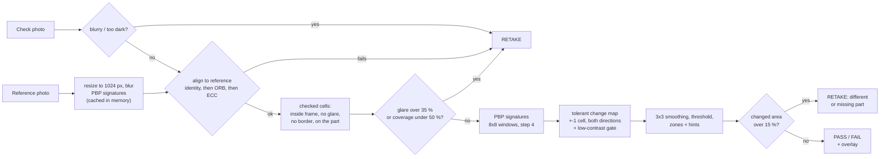
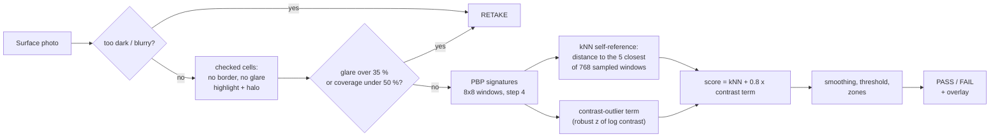

# AVA — detailed documentation

**Visual defect check for parts from a phone photo. It needs no defect training data and no light box.**

Mode: **Startup**. AVA is a standalone product for automotive component plants, assembly lines (paint, stamping and casting shops) and incoming-inspection areas. An inspector takes a photo of a part with a phone. AVA answers **PASS**, **FAIL** (with the defect zones outlined) or **RETAKE** (with the reason). AVA needs no examples of defects and no model training, and it runs on an ordinary CPU. The comparison is built on pseudo-Boolean polynomial (PBP) window signatures (Chikake & Goldengorin). Monotone lighting drift on a shop floor (ageing lamps, camera auto-exposure, daylight from a window) keeps the score below the threshold. The classic golden-template approach, plain reference subtraction, reads that same drift as a defect, which is why it is normally installed inside a light box.

**Live demo:** the Hugging Face Space linked in this repository's *About → Website* field (deployment: [docs/DEPLOY.md](docs/DEPLOY.md)). Open it on a phone. The camera needs HTTPS, which the Space provides. The QR button in the header passes the link to another phone.

---

## The two modes

The user picks the mode on the first screen. The choice depends on what is being inspected.

| | **Surface check** (1 photo) | **Compare with reference** (2 photos) |
|---|---|---|
| Use it for | Uniform surfaces with the same texture everywhere: painted, plastic or smooth metal. Brushed metal gives more false alarms (see the limitations); fabric and mesh are untested. | Complex parts with holes, ribs, logos, seams or other unique features. |
| Photos | One photo that shows **only the surface**. | A **Reference** photo of a good part, then a **Check** photo of the part to inspect, taken from the same angle. |
| Idea | Normal windows of a uniform surface have many look-alikes elsewhere in the same photo. A scratch, chip, stain or sticker edge is rare. The surface is its own reference. | The Check photo is aligned to the Reference, and the two are compared window by window. Only what *changed* is reported. |
| API | `POST /api/scan` | `POST /api/compare` |
| Code | `ava/surface.py` | `ava/pipeline.py` |
| Side panel | — | Plain reference subtraction on the same aligned photo, for comparison. |

The reference stays on screen after a check, so many parts can be checked against one reference. The page also keeps the last 10 results of the session.

### The four demo scenarios

Each scenario can be run from the built-in examples ("Try an example" buttons, synthetic images in [`web/examples/`](web/examples/README.md)) and with a live camera. The buttons only load the images into the slots. The verdict always comes from the real API, and `tests/test_demo_examples.py` checks all four.

| Mode | Case | Expected result |
|---|---|---|
| Surface check | Uniform texture **with** a defect | FAIL, defect zone highlighted |
| Surface check | The same texture **without** a defect | PASS, no zones |
| Compare with reference | Reference + the same part **with** a defect | FAIL, zone on the defect |
| Compare with reference | Reference + the same part under a strong global brightness/colour change, **no** defect | AVA: PASS. Plain subtraction panel: "FAIL — a large part of the frame changed" (more than 15 % of the checked area; the API answers RETAKE: mismatch, and the benchmark counts it as a retake, not as a false alarm) |

---

## How it works

### Compare with reference (Mode 2)



Before alignment the Check photo is brought to the Reference's working scale, so photos of different resolutions still align. A bright, unsaturated blob that only the Check photo has is masked like glare, but it can be a white label, tape or bare metal: it never ends in a PASS (`RETAKE: glare` with the hint to check the spot by eye, unless a zone elsewhere already gives FAIL).

### Surface check (Mode 1)



If a glare core of at least 64 px was masked and no zone was found, the answer is `RETAKE: glare` instead of PASS, for the same reason as in Mode 2.

Module-level detail is in [docs/ARCHITECTURE.md](docs/ARCHITECTURE.md). The module and API contract is [docs/SPEC.md](docs/SPEC.md).

### PBP in one example

**Definition** (Chikake & Goldengorin). Take an *m × n* window *C*. Its rows are Boolean variables *y₁ … yₘ*. For every column:
- the column minimum goes into the constant;
- every step up from a value *prev* to the next distinct value *t* adds the term `(t − prev) · ∏ yᵢ` over the rows *i* with `C[i, j] < t`.

Like monomials are then merged. The published example polynomial is reproduced exactly by `ava.pbp.pbp_reference` (see `tests/test_pbp.py`) on the 4 × 3 matrix

```
A = [[ 9,  6, 14],
     [11, 10, 10],
     [ 4, 16,  4],
     [17,  3, 20]]

B(A)      = 11 + 11y3 +  3y4 + 2y1y3 + 4y2y3 + 4y1y4 + 12y1y2y3 +  6y1y2y4
B(2A + 5) = 37 + 22y3 +  6y4 + 4y1y3 + 8y2y3 + 8y1y4 + 24y1y2y3 + 12y1y2y4
```

Doubling the brightness and adding 5 leaves **the same monomials**. The non-constant coefficients double, and only the constant absorbs the offset.

**What is invariant, stated precisely:**
1. **The set of monomials** depends only on the order of the values in each column, ties included. It does not change under any **strictly monotone** brightness change (gain, gamma, exposure curve).
2. **The coefficients** are differences of sorted values, so they do change. AVA drops the constant and normalises each window's coefficients to sum 1. Under a **positive affine** change `a·x + b` (a > 0) the whole normalised signature is therefore invariant. The ε-tie margin scales with the window's own contrast, so it scales along. **Exception:** a window whose contrast crosses the absolute flat floor (6 gray levels) becomes "flat", and flat vs non-flat counts as fully changed. Mode 2 ignores such a disagreement when the two windows' contrasts, corrected for the global exposure gain, agree within a factor of 2 (`pipeline._change_map`); without that rule the bundled reference darkened to ×0.5 gave a false FAIL with 12 zones.
3. **Under a non-linear monotone change** (gamma, an auto-exposure curve) the monomials stay the same, but the normalised coefficients shift a little. Over the narrow intensity range of one 8 × 8 window such a curve is close to `a·x + b`. The claim is therefore that *lighting changes keep the score below the threshold*, not that the score is exactly zero. A spatially varying gain (light from one side) is close to constant inside one window, and every window normalises on its own.
4. **Not covered:** clipping at 255, a specular highlight that moves, a hard shadow edge, and a change of the **light direction** on a relief part (a lamp moved to the other side flips the shading of ribs and edges). These change the local order and are reported below as failure cases.

AVA does **not** use the polynomial degree as the defect signal. On real pixels the degree is almost always at its maximum. Each window is compared on its **full monomial structure**:
- 256 normalised coefficients per orientation, in two orientations (rows and columns as the variables);
- with ε-ties, so that sensor noise does not invent an order;
- with the distance 0.5·L1, averaged over the two orientations.

---

## Results

> **All numbers below are on SYNTHETIC, procedurally generated images**, not on real factory photos. They compare methods under identical controlled conditions and are not a real-world accuracy claim. The tables are copied verbatim from the generated files [eval/RESULTS.md](eval/RESULTS.md) and [eval/RESULTS_SURFACE.md](eval/RESULTS_SURFACE.md), which also give the protocol, the per-lighting, per-defect and per-motion tables, the AUROC and the caveats.

### Mode 2: compare with reference (synthetic)

1792 TEST pairs: 4 part kinds × 8 lightings × 2 motions × 7 defect classes × 4. For every method, the thresholds were calibrated on a disjoint CALIB split (≤ 0.05 false events per good pair), then frozen.

**Lighting: none + monotone (the operating domain), 1152 defect pairs and 192 defect-free pairs**

| Method | Defect recall | Escapes (defect → PASS) | False-alarm rate (good → FAIL) | Good parts not passed (FAIL or RETAKE) | False zones / pair | Retake rate (all) | Coverage | Mean ms / inspection |
|---|---|---|---|---|---|---|---|---|
| pbp | 67.8% (65.0–70.4) | 23.6% (21.2–26.1) | 1.0% (0.3–3.7) | 2.1% (0.8–5.2) | 0.039 | 3.1% (2.3–4.1) | 94.3% | 495 |
| census | 26.5% (24.0–29.1) | 62.3% (59.5–65.1) | 2.1% (0.8–5.2) | 3.1% (1.4–6.6) | 0.026 | 3.3% (2.4–4.4) | 94.3% | 248 |
| ssim | 67.3% (64.5–69.9) | 24.9% (22.5–27.5) | 1.0% (0.3–3.7) | 2.1% (0.8–5.2) | 0.021 | 2.8% (2.1–3.9) | 94.3% | 205 |
| pixdiff | 16.1% (14.1–18.3) | 75.0% (72.4–77.4) | 2.1% (0.8–5.2) | 3.1% (1.4–6.6) | 0.053 | 4.7% (3.7–6.0) | 94.3% | 225 |

`pixdiff` is plain reference subtraction. Brackets are Wilson 95 % intervals.

**Paired comparison on the same TEST pairs (none + monotone)**

| Lighting | vs | Recall PBP vs it | Defects found only by PBP / only by it | McNemar p | Recall | False alarms PBP vs it | False alarms only PBP / only it | McNemar p | False alarms |
|---|---|---|---|---|---|---|---|---|---|
| none+monotone | census | 67.8% vs 26.5% | 479 / 3 | 3e-138 | PBP better | 1.0% vs 2.1% | 2 / 4 | 0.69 | no significant difference |
| none+monotone | ssim | 67.8% vs 67.3% | 68 / 62 | 0.66 | no significant difference | 1.0% vs 1.0% | 0 / 0 | 1 | no significant difference |
| none+monotone | pixdiff | 67.8% vs 16.1% | 605 / 9 | 9.6e-166 | PBP better | 1.0% vs 2.1% | 2 / 4 | 0.69 | no significant difference |

### Mode 1: surface check (synthetic)

Uniform painted, plastic, brushed-metal and dark glossy surfaces that fill the whole frame. 1152 TEST photos. The thresholds were calibrated on a disjoint CALIB split (≤ 5 % false alarms).

**Lighting: none + monotone (the operating domain), 576 defect photos and 288 defect-free photos**

| Method | Defect recall | False-alarm rate (good → FAIL) | False zones / photo | Retake rate | Coverage | Mean ms (sequential) | Mean ms (parallel) |
|---|---|---|---|---|---|---|---|
| PBP (AVA) | 97.9% (96.4–98.8) | 5.2% (3.2–8.4) | 0.057 | 0.0% (0.0–0.4) | 93.5% | 187 | 343 |
| Census kNN | 97.9% (96.4–98.8) | 5.9% (3.7–9.2) | 0.046 | 0.0% (0.0–0.4) | 93.5% | 106 | 202 |
| Gradient z-score | 97.9% (96.4–98.8) | 3.1% (1.7–5.8) | 0.035 | 0.0% (0.0–0.4) | 93.5% | 65 | 119 |

### Honest reading

- **Against plain reference subtraction** (the classic golden template), PBP finds about **4× more defects** (67.8 % vs 16.1 % recall) at the same calibrated false-alarm budget (1.0 % vs 2.1 %). The recall difference is significant (McNemar p ≈ 9.6e-166). This is the main result.
- **Against SSIM it is parity, not a win.** Recall 67.8 % vs 67.3 % (McNemar p = 0.66, no significant difference) at the same false-alarm rate (1.0 %), and SSIM is about 2.4× faster (205 vs 495 ms in the same timing pass). What AVA adds over a bare SSIM score:
  - the zone hints (dirt or drop; texture smoother or rougher than in the reference, from the PBP degree and contrast);
  - a single-photo surface mode.

  The per-window signature has an interpretable structure (which monomial bins carry the weight), but the API and UI do not expose it yet.

  A PBP + SSIM ensemble is the next step.
- **Census**, PBP's closest relative (both use intensity order), has much lower recall in this implementation. The likely reason is that it has no noise margin. See the caveats in RESULTS.md.
- **Mode 1: the synthetic set is too easy to separate the methods.** All three methods reach 97.9 % recall, and the gradient baseline has fewer false alarms (3.1 % vs 5.2 %). On these surfaces the contrast-outlier term does most of the detection. Real photos are pending.
- **No real-data metric is claimed yet.** The VisA download was abandoned (see RESULTS.md). The team's own photo set follows the protocol in [data/pairs/README.md](data/pairs/README.md).

---

## Engineering constraints

| Question | Answer |
|---|---|
| **Where does inference run?** | On **CPU**, inside the FastAPI process: NumPy + OpenCV. There is no GPU, no neural network and no external AI API.<br>• Demo: the Hugging Face Space (Docker, *CPU Basic*, 2 vCPU).<br>• Production: an on-premise mini-PC or laptop at the inspection station, with phones or an IP camera on the local network. The same Docker image runs there. |
| **Speed (our measurement only)** | Measured on the team laptop, a **13th Gen Intel Core i5-13450HX**, in the sequential timing pass of the benchmark (1280×720 images, worked at max side 1024 px):<br>• **Mode 2, PBP: mean 495 ms, median 443 ms per inspection.** This includes alignment, masks, signatures, change map, zones and overlay JPEGs. Preparing the reference once costs a median of 132 ms more, and it is then cached.<br>• **Mode 1, PBP: mean 303 ms per photo (sequential pass, eval/RESULTS_SURFACE.md).**<br>Source: the "Speed" sections of [eval/RESULTS.md](eval/RESULTS.md) and [eval/RESULTS_SURFACE.md](eval/RESULTS_SURFACE.md). The 2-vCPU Space is slower and was not benchmarked. Every API response carries its own `timing_ms`. Upload time over the network is not included. |
| **Cost per camera and per inspection** | All software dependencies are open source, so there are no licence fees.<br>• `cost_per_inspection = (H + A + S) / N`<br>• `H` = hosting per month. Hugging Face (checked 2026-10-11, [docs/SOURCES.md](docs/SOURCES.md) "Hosting"): CPU Basic hardware (2 vCPU) is free; creating a new Docker Space requires a paid plan, PRO at $9/month; CPU Upgrade (8 vCPU) is $0.03 per hour, about $22 for a month of 24/7 running. On-prem: the electricity of the station PC.<br>• `A` = hardware amortisation per month (mini-PC, phone or IP camera, tripod, lamp, divided by the months of use), `S` = support per month and `N` = inspections per month are **pilot inputs**: they come from the pilot site's quotes and plant data, and the deck states each value with its source.<br>• Capacity check: one host handles at most about `2 × 3600 / t` inspections per hour (2 concurrent CPU jobs, `t` = seconds per inspection measured on that host).<br>• Cost per camera per month = `(H + A + S) / cameras per host`.<br>We do not quote prices that we have not sourced. |
| **Night and low light** | The station is indoors, so "night" means weak, dimmed or ageing lamp light. That is covered by the lighting benchmark: the `drift_gain`, `lamp_aging` and `auto_exposure` rows in both RESULTS files.<br>• A photo with a mean gray level below 35 is answered `RETAKE: dark`.<br>• Sensor noise in weak light is handled by the working blur, ε-ties and the low-contrast gate. |
| **Glare and hard shadows** | **Known failure.** A moving specular highlight or a hard hand shadow changes the local intensity order. In Mode 2 the PBP false-alarm rate under these conditions is 93.8 % (all methods fail). Large glare areas are turned into `RETAKE: glare` with the hint to change the angle by 15–30°. A bright blob that may hide a white defect is never passed (see "How it works"). |
| **Rain, local cars, licence plates** | **Not applicable.** AVA is an indoor inspection station for parts on a table or belt. It never sees roads, weather, vehicles or plates, so no claim is made about them. |

---

## Known limitations and failure cases

All numbers are from the synthetic benchmark files.
- **Non-monotone lighting** (moving specular highlight, hard hand shadow). This is the expected failure for every method.
  - Mode 2: PBP false-alarm rate 93.8 %, SSIM 84.4 %, subtraction 62.5 %.
  - Mode 1: PBP false-alarm rate 52.1 %, and 100 % under a hand shadow.
- **Escapes.** In Mode 2, 23.6 % of defect pairs are judged PASS (none + monotone lighting). AVA is an assistant to the inspector, not a replacement.
- **Part moved on the belt.** In Mode 2, recall is 50.0 % when the part is moved by up to 40 px / 3° over a static background, against 85.6 % under small camera jitter. With a moved part only the part's keypoint hull is checked, and a per-cell minimum over the part- and background-registered views lowers defect scores.
- **Small burrs.** In Mode 2, PBP recall on burrs is 25.5 % (SSIM 43.2 %).
- **Mode 1 needs a photo of the surface only.** Part edges, holes, logos, labels, the background or a hand in the frame are "rare" as well and become zones. Complex parts belong to Mode 2. On brushed metal the Mode 1 false-alarm rate is 20.8 %.
- **Moving the lamp or casting a shadow.** Changing the light *direction* on a relief part (stamped, molded, machined) flips the shading order on ribs, edges and grooves, and a soft shadow edge is a non-uniform gain inside a window. On synthetic parts re-rendered with the relief light moved by 90° or 180°, PBP gave false FAILs in most stamped, molded and machined cases while plain subtraction passed (a development check, not a benchmark row: the benchmark's lighting changes are pixel-wise and never move the light source). Change brightness only: dim or brighten the same lamp, or use a diffuse light next to the camera, and keep shadows off the part.
- **Strong darkening.** The benchmark covers global gains from 0.65 to 1.6 (`drift_gain`, `lamp_aging`, `auto_exposure`). Outside that range there are no benchmark numbers; the bundled reference darkened to ×0.5 and ×0.4 passes (`tests/test_demo_examples.py`). Below a mean gray level of 35 the answer is `RETAKE: dark`.
- **White or clipped defects.** A white label, white tape or bare metal clipped to 255 looks exactly like glare. AVA does not pass such a frame, but it answers `RETAKE: glare` rather than FAIL when nothing else changed.
- **Dents without raking light.** A shallow dent changes only the shading. Under diffuse light it can be invisible to any 2-D method.
- **Low-texture parts in Mode 2.** ORB needs corners. Smooth parts fall back to ECC alignment, which is accepted only at correlation ≥ 0.85; otherwise the answer is `RETAKE: alignment`.
- **No semantics.** AVA reports *differences*, from the reference or from the rest of the surface. It does not know whether a difference is acceptable.
- **Synthetic data only.** Real photos and VisA have not been evaluated yet.

---

## Quick start

Requires Python 3.11.

```bash
pip install -r requirements.txt
uvicorn server.app:app --reload
```

- Open <http://localhost:8000>.
- **The live camera needs a secure context.** Browsers expose the camera only on `https://` or `http://localhost`. A phone that opens `http://192.168.x.x:8000` can still pick photos from its gallery, but it gets no live camera. For a phone, use the Space or a tunnel (`cloudflared tunnel --url http://localhost:8000`, see [docs/DEPLOY.md](docs/DEPLOY.md)).
- Docker (the same image as the Space):

  ```bash
  docker build -t ava .
  docker run --rm -p 7860:7860 ava      # http://localhost:7860
  ```

## Tests

```bash
pip install -r requirements-dev.txt
python -m pytest -q
```

The suite covers:
- the published PBP example and exactness of the vectorised signatures against the reference implementation;
- the monotone and affine invariance tests;
- the alignment paths, including part motion;
- the change maps, zones and the pipeline on synthetic parts;
- Mode 1;
- the HTTP API and the static UI;
- smoke runs of both benchmarks;
- `tests/test_demo_examples.py`, which runs the real pipeline on the five demo images and asserts the four expected verdicts. **Do not deploy if it fails.**

## Reproduce the benchmarks

The commands come from the "Run" sections of the result files. Each run rewrites `eval/results/*.json` and the matching RESULTS file.

**Mode 2** ([eval/RESULTS.md](eval/RESULTS.md)). Calibrate, then test on a disjoint split (one command), then run the sequential timing pass:

```bash
python -m eval.benchmark --n 4 --seed 0 --workers 8 --visa-note "A download of VisA_20220922.tar (about 1.8 GB) was attempted on 2026-10-10; measured speed was 40-50 KB/s (about 10 hours), so it was abandoned."
python -m eval.benchmark --split timing --timing-pairs 24
```

The CALIB thresholds are printed and stored in `eval/results/calib.json`; they are copied into `ava/config.py` by hand.

**Mode 1** ([eval/RESULTS_SURFACE.md](eval/RESULTS_SURFACE.md)):

```bash
python -m eval.benchmark_surface --n 4 --clean-mult 3 --seed 0 --workers 10
```

**Demo examples** ([web/examples/](web/examples/README.md)):

```bash
python -m eval.make_examples
```

The full Mode 2 run took about 52 minutes (calib 1288 s, test 1854 s) with 8 worker processes on the i5-13450HX. For Mode 1 see eval/RESULTS_SURFACE.md.

---

## API

JSON over HTTP; interactive docs are at `/api/docs`. Errors come back as `{"error": code, "message": text}` with a 4xx/5xx status.

**Upload rules:**
- multipart/form-data, JPEG, PNG or WebP (other formats are rejected with `bad_image`; 16-bit gray PNGs are scaled to 8 bits);
- at most 15 MB per file and 40 MP;
- EXIF orientation applied;
- at least 64 px on the short side.

### `GET /api/health`

```json
{"ok": true, "version": "0.2.0", "params": {"threshold": 0.58331, "threshold_pixdiff": 0.2512, "surface_threshold": 0.23764, "...": "every field of ava.config.Params"}}
```

### `POST /api/scan` (Mode 1)

Multipart field `image`. Response:

```json
{"result": <result>, "overlay": "<base64 JPEG>", "image_sha256": "<hex>"}
```

### `POST /api/compare?methods=pbp,pixdiff` (Mode 2)

Multipart fields `reference` and `frame`. `methods` is a comma list of `pbp`, `ssim`, `census` and `pixdiff`; the default is `pbp,pixdiff`. Response:

```json
{"results": {"pbp": <result>, "pixdiff": <result>},
 "overlays": {"pbp": "<base64 JPEG>", "pixdiff": "<base64 JPEG>"},
 "reference_sha256": "<hex>", "frame_sha256": "<hex>"}
```

### `<result>` (both modes)

| Field | Meaning |
|---|---|
| `verdict` | `"pass"`, `"fail"` or `"retake"` |
| `reason` | `null`, `"alignment"`, `"glare"`, `"blurry"`, `"dark"`, `"low_coverage"` or `"mismatch"` (Mode 2: changed area > 15 % means a different or missing part) |
| `zones` | ranked list of `{id, bbox [x,y,w,h], bbox_norm, n_cells, area_px, mean_score, max_score, hint, contour}`. `hint` is `null`, `"water_or_dirt"`, `"something_removed"` or `"something_added"`. The last two only say that the zone's texture is smoother / rougher than in the reference (smooth tape on brushed steel reads as "removed"); the UI words them that way. |
| `coverage` | fraction of the image (Mode 2 with a moved part: of the part) that was checked |
| `changed_frac` | fraction of checked cells at or above the threshold |
| `align` | Mode 2: `{method: "identity" or "orb" or "ecc", n_inliers, inlier_ratio, score}`. Mode 1: `{}`. |
| `timing_ms` | per-stage times and `total` |
| `method` | `"pbp"`, `"pixdiff"` and so on; Mode 1: `"pbp_surface"` |
| `threshold` | the threshold that was used |
| `signature_sha256` | SHA-256 fingerprint of the signatures |
| `hints` | e.g. `["change_angle"]` on glare; `["change_angle", "bright_spot"]` when a bright blob that may be a white defect was not checked |
| `work_size` | `[w, h]` of the working image; `bbox` is in these pixels |

Error codes include `bad_image`, `empty_file`, `image_too_small`, `too_large`, `too_many_pixels`, `file_required`, `multipart_required`, `bad_methods` and `internal`.

## Privacy

- **Photos are processed in memory and are not stored.**
  - Uploads are decoded in memory. Multipart parts are kept in memory rather than spooled to disk.
  - Nothing is written to disk, and nothing is sent to a third party.
  - To make repeated checks against the same reference faster, the prepared reference (resized image and signatures) stays in an in-memory LRU of at most 4 entries until it is evicted or the process restarts.
- **The web UI loads no third-party resources:** no CDN, analytics or remote fonts. The QR code is drawn in the browser.
- **The browser stores** only the selected mode and the camera-overlay opacity, in `localStorage`. The result history lives in the page and is gone on reload.
- **Data:** the built-in and benchmark images are procedural and contain no faces, people or licence plates. When you take your own photos, frame only the part.

## Data sources and licences

| Data | Source | Licence | Use |
|---|---|---|---|
| Synthetic parts, surfaces, defects and shop lighting | **Procedural**, generated by `ava/synth.py`:<br>• parts: stamped, painted, molded, machined, on belt, steel-table and ESD-mat backgrounds;<br>• uniform surfaces: painted, plastic, brushed, glass_dark;<br>• defects: scratch, tape, sticker, dent, missing hole, burr, stain, chip;<br>• lighting: gain drift, gamma, window gradient, lamp ageing, auto-exposure, specular, hand shadow;<br>• camera jitter and part motion.<br>Seeded and deterministic, no external images. | Our code (MIT) | Calibration, benchmarks, tests. Always labelled synthetic. |
| Demo examples (`web/examples/*.jpg`) | Generated by `eval/make_examples.py` from `ava/synth.py` | MIT (part of this repository) | "Try an example" buttons |
| VisA (Amazon) | <https://registry.opendata.aws/visa/> | CC BY 4.0 | **Not used.** The download was attempted and abandoned (see eval/RESULTS.md). |
| MVTec AD, KolektorSDD, CarDD | — | Non-commercial only | **Not used** |
| Team photos | Own objects of Team AVA ([protocol](data/pairs/README.md)), no faces or plates | CC BY 4.0 | Real test set, **when added**. No results yet. |

Full references are in [docs/SOURCES.md](docs/SOURCES.md).

## Credits and licences

**Method.** Pseudo-Boolean polynomials for images are the work of **T. M. Chikake and B. I. Goldengorin** (with P. M. Pardalos):
- T. M. Chikake, B. I. Goldengorin, P. M. Pardalos. *Computer Optics* 49(6), 2025. [doi:10.18287/COJ1815](https://doi.org/10.18287/COJ1815)
- T. M. Chikake, B. I. Goldengorin. *Image edge detection using pseudo-Boolean polynomials.* ICMV 2023, Proc. SPIE 13072. [doi:10.1117/12.3023452](https://doi.org/10.1117/12.3023452)
- T. M. Chikake, B. Goldengorin, A. Samosyuk. Springer Optimization and Its Applications, 2023. [doi:10.1007/978-3-031-31654-8_5](https://doi.org/10.1007/978-3-031-31654-8_5)
- T. M. Chikake, B. I. Goldengorin, P. M. Pardalos. *Trends in Biomathematics* (BIOMAT), Springer 2025. [doi:10.1007/978-3-031-97461-8_3](https://doi.org/10.1007/978-3-031-97461-8_3)

The authors' library is [`tmc-pbp`](https://github.com/Tenfleques/tmc-pbp) (MIT). It is **not** a dependency: `ava/pbp.py` is our own independent implementation. The window signatures with ε-ties and normalisation, the tolerant comparison, the surface kNN score and the pipeline are ours.

**Bundled code.** `web/qrcode.js` is qrcode-generator by **Kazuhiko Arase**, MIT licence (header kept). "QR Code" is a registered trademark of DENSO WAVE INCORPORATED.

**Dependencies:**

| Package | Licence |
|---|---|
| NumPy | BSD-3-Clause |
| OpenCV (`opencv-python-headless`) | Apache-2.0 |
| FastAPI | MIT |
| Starlette, AnyIO (via FastAPI) | BSD-3-Clause, MIT |
| Uvicorn | BSD-3-Clause |
| Pillow | MIT-CMU |
| python-multipart | Apache-2.0 |
| pytest (dev) | MIT |
| httpx (dev) | BSD-3-Clause |

`requirements.txt` pins exact versions, so the Docker image runs the stack the tests and benchmarks ran on (versions in [docs/SOURCES.md](docs/SOURCES.md)).

AVA is MIT-licensed ([LICENSE](LICENSE)), © 2026 Team AVA.

## Repository layout

```
ava/          core library: pbp, change, align, quality, zones, baselines, pipeline, surface, synth, config
server/       FastAPI app: /api/health, /api/scan, /api/compare + the static UI
web/          vanilla-JS mobile UI (English), no build step, no CDN; examples/ = demo images
eval/         benchmark.py, benchmark_surface.py, make_examples.py -> RESULTS.md, RESULTS_SURFACE.md
tests/        pytest suite
docs/         SPEC (contract), ARCHITECTURE, DEPLOY, SOURCES
data/pairs/   protocol for the team's own real photos
Dockerfile    Hugging Face Spaces image (port 7860)
```

---

**Team AVA**, WIUT Hackathon 2026 final, Computer Vision track.
